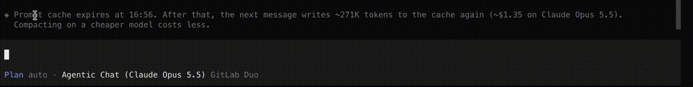

# opencode-cache-coach

An [OpenCode](https://opencode.ai) plugin that coaches you on making better use of your tokens.
It connects token usage and estimated costs to practical choices: when to compact, which model to
compact on, and how to avoid carrying oversized tool results through the rest of a session.

Your conversation and tool results become input to later requests. Prompt caching makes reusing
that context cheaper, but switching models, letting the cache expire, or crossing a higher-price
context threshold can make the next request more expensive. Cache Coach explains these trade-offs
as you work, with cost comparisons and suggestions based on your session and model prices.

The cache indicator and `/cache` details show where you stand. Tips and expiry messages help you
decide what to do next, such as compacting while the cache is warm or using a cheaper model when
the context must be written again. Cache health tracking shows when requests stop reading the context
from the cache, and warns when that persists.


Requires OpenCode 2.2 or later. See the [source repository](https://github.com/pedropombeiro/opencode-plugins/tree/main/packages/cache-coach)
for local builds and the [MIT license](https://github.com/pedropombeiro/opencode-plugins/blob/main/LICENSE).

## Installation

```bash
opencode plugin add opencode-cache-coach
```

This adds the plugin to your `opencode.json`:

```json
{
  "$schema": "https://opencode.ai/config.json",
  "plugins": ["opencode-cache-coach"]
}
```

The CLI part shows the indicator, tips, and expiry messages. The Desktop part shows the same
indicator, details, and tips in OpenCode Desktop; see [OpenCode Desktop](#opencode-desktop). The
server part only keeps the expiry messages out of model requests.

## Cache indicator

The prompt footer shows the cache state of the session on screen:


| Footer                                 | Meaning                                                                  |
| -------------------------------------- | ------------------------------------------------------------------------ |
| `● cache 3:42`                         | Warm. The next message reads the context from the cache.                 |
| `◐ cache 0:45`                         | Warm, with less than a minute left.                                      |
| `● cache`                              | A request is running and using the cache.                                |
| `○ cache cold · rewrite ~180K ($0.90)` | Expired, or another model is selected. The next message writes it again. |
| `○ cache cold · … · GPT-6.1 Sol $0.45` | As above, and compacting on your `compactionModel` costs less.           |
| `● cache 3:42 · warming?`              | Warm, in a session that OpenCode warms. See [Warming](#warming).         |

The footer stays empty until the session has a request whose provider reports cache tokens. Click
the indicator, or run `/cache`, to see the last request's cache hit rate, what the next message
costs, and the session's cost so far.

The countdown starts when the last request started, and uses the cache lifetime from the plugin's
[`ttl`](#options) option, the model's or provider's `cache.ttl` setting, or 5 minutes. Providers can
evict a cache earlier, so a warm indicator means the cache is likely warm.

OpenCode also sends the model's `cache.ttl` to the provider. To change only the countdown, set the
plugin's `ttl` option. A string such as `"1h"` applies to every model. To set the lifetime for some
models, map `providerID/modelID` patterns to lifetimes:

```jsonc
{
  "package": "opencode-cache-coach",
  "options": {
    "ttl": {
      "gitlab/*-sol": "30m",
      "gitlab/*-astra": "30m",
      "anthropic/*": "1h",
    },
  },
}
```

- `*` matches any run of characters, including `/`. Matching is case-sensitive.
- A key without `*` that equals the model wins. Otherwise, the matching pattern with the most
  characters other than `*` wins, and ties go to the key listed first.
- Models that no key matches use the model's or provider's `cache.ttl`, or 5 minutes. A `"*"` key
  sets a default for the plugin only.
- The plugin ignores keys whose lifetime it can't read.

The lifetime also applies to expiry notices, the model-switch tip, and [cache health](#cache-health).

### Warming

When OpenCode's [`warming`](https://opencode.ai/docs/warming/) option covers a session, OpenCode
sends keep-alive requests while you're idle. Those requests add no messages, and the plugin can't
see whether they renew the cache. With GitLab Duo models, requests after a keep-alive request still
missed the cache in testing. So the countdown doesn't count on warming, and ends in `· warming?` to
show that the cache might last longer.

The plugin reads the `warming` setting from the top level of your configuration and from the
model's or provider's `settings.cache.warming`, once per directory. Restart OpenCode after you
change `warming`.

## Expiry messages

Shortly before the cache of a large context expires, the plugin adds a message to the session, so
it's the last thing you see when you come back:

```text
◈ Prompt cache expires at 14:32. After that, the next message writes ~225K tokens to the cache
  again (~$1.13 on Claude Opus 5.5). To compact, switch to GPT-6.1 Sol first (~$0.56), run
  /compact, then switch back.
```

A compaction after the cache expires writes the whole context again, so compacting on a cheaper
model saves most of that cost. Set `compactionModel` to name the model. Without it, the message
only says that a cheaper model costs less.

This recording shows the expiry advice and footer as the user switches to GPT-6.1 Sol and
starts compaction. The plugin suggests the change; it doesn't switch models or compact automatically.



The message appears once each time the session goes idle, in top-level sessions whose last request
the TUI saw finish, and only when the next message writes at least `minTokens` and costs at least
`minCost`. The server part removes these messages from every model request, so the model never
sees them and the cache isn't affected.

## Tips

The plugin shows a toast when it spots one of these patterns. Each tip appears at most once per
session, except the model-switch tips, which appear for every switch away from a new request:

- **Model switch on a warm cache.** Selecting another model for a large context means the next
  message writes it to a new cache. The tip compares that with staying on the current model and
  suggests compacting first.
- **Model switch after the cache expired.** The next message writes the context again on any model,
  so the tip says when the new model, or your `compactionModel`, can compact it for less.
- **Close to the context ceiling.** At 80% of the ceiling (`contextRatio`), the tip suggests
  compacting while the cache is warm, and shows what the same compaction costs after the cache
  expires. The ceiling is 250K tokens by default. For a model that charges more above a prompt
  size, such as Claude Haiku 5.5 above 100K tokens, the default ceiling is that size instead.
- **Large tool output.** A tool result stays in every later request in the session. The tip
  suggests asking for a narrower result next time.
- **Warming didn't keep the cache.** When warming is on and a request within the warming window
  still writes the context again, the tip says what that cost, and suggests turning warming off for
  the model, because its keep-alive requests cost money too. A provider can also drop a cache early,
  so one miss isn't proof that warming never works.

Tips stay in the TUI and never enter the conversation, so they don't add tokens or change the
cache. Subagent sessions don't get tips.

## Cache health

The plugin tracks when a session stops reading its context from the cache. It measures the share
of input tokens that came from the cache, counting uncached input, cache reads, and cache writes,
and leaving out output and reasoning tokens. It opens an incident in two cases:

- **Sustained misses.** Over 4 requests in a row on the same model, with at least 100K input tokens
  in total, less than 5% came from the cache.
- **Regression.** After a healthy stretch of at least 5 earlier requests in the session with 50% or
  more read from the cache, the last 4 requests drop by at least 40 percentage points, to under 30%.

Many incidents end on their own before you could act on them, so the plugin doesn't interrupt you
when one opens. `/cache` lists the incidents of the session, an estimate of the tokens that weren't
read from the cache, and their extra cost. It also says whether the misses read little or nothing
from the cache or only the start of each prompt, which helps in a report to the provider:

```text
Cache misses this session: 2 incidents. In total, an estimated ~1.2M tokens from earlier prompts
weren't read from the cache (~$7.10 extra).
Last incident on gitlab/duo-chat-opus-5@build: 7 requests, ended. In most of the missed requests,
little or nothing was read from the cache.
```

The plugin warns only when an incident persists, after 3 more requests that read less than 30% from
the cache:

```text
Cache reuse is still low for Opus 5: under 1% of 404K input tokens came from the cache across the
last 4 requests. In most of the missed requests, little or nothing was read from the cache. Over 7
requests, an estimated ~690K tokens from earlier prompts weren't read from the cache (~$3.97
extra). Each missed request processes the context again, so compacting makes misses cheaper.
Possible causes include prompt-prefix changes, cache configuration, or provider-side misses. Run
/cache for details to include in a report.
```

The incident ends when the last 3 requests together read at least 50% from the cache, or the
earlier share minus 20 percentage points when that's higher. After a warning, the plugin says once
that the cache recovered. The earlier share stays fixed while an incident is open, so a long
failure doesn't become the new normal.

The cache counters can't tell why reuse dropped, so the warning lists likely causes and doesn't
blame the model. The plugin only counts requests that could have read the cache:

- The first request on a model, variant, or agent, the first after compaction, and the first after
  a gap longer than the cache lifetime only start the cache, so they don't count. Each agent has its
  own system prompt and tools, so the plugin tracks each agent separately. Warming doesn't extend
  the gap, because the plugin can't see whether it works.
- Requests with fewer than 8K input tokens, failed requests, and requests without usage don't count.
- OpenCode reports missing cache counts as 0. So requests without cache reads or writes only count
  as misses after the provider reported cache use for that model in the session, or when the model
  has cache prices. Some providers don't report cache use at all, so incidents from the second case
  appear in `/cache` marked as assumed, stay out of its totals, and never show a warning. When the
  provider later reports cache use, the assumed incident ends, and detection starts again from
  that request.
- Each session has its own history, so requests in other sessions or subagents don't affect it.
  Subagent sessions get no warnings.
- A single missed request doesn't open an incident, so `/cache` doesn't count isolated misses.

The estimated tokens not read from the cache are the previous request's prompt minus what the
request read from the cache. The extra cost compares what they cost with the cache-read price.
Detection doesn't depend on prices, so it works for models without prices, and then `/cache` shows
only token counts. In OpenCode Desktop, a warning or recovery also sends a system notification. The
plugin keeps this history in memory, so it starts over when OpenCode restarts.

## OpenCode Desktop

In OpenCode Desktop, a pill above the composer shows the cache state, such as `cache 3:42` or
`cache cold · rewrite ~180K ($0.90)`. Click it, or run `/cache`, to open the **Prompt cache** side
panel. The panel shows the same details as the CLI, a cheaper compaction model when one applies,
and the pending expiry advice.

Tips appear as toasts. Shortly before the cache of a large context expires, a toast and a system
notification show the expiry advice, instead of a message in the session. Desktop sends
notifications only when they're turned on in **Settings > Notifications**.

Desktop coaches sessions open in its tabs, on every server it connects to. The plugin never
switches models, compacts, or calls a model on its own.

The OpenCode web app doesn't load Desktop parts, so it shows no cache indicator.

## Options

The CLI part reads its options from `cli.json`. OpenCode Desktop reads them from the plugin entry
in your global `opencode.json`, so set them in both files to use them in both apps. Use the object
form of the package entry. OpenCode still loads the plugin once:

```json
{
  "plugins": [
    {
      "package": "opencode-cache-coach",
      "options": { "compactionModel": "gitlab/duo-chat-gpt-6-1-sol", "contextCeiling": 180000 }
    }
  ]
}
```

| Option            | Default                                  | Description                                                                                                                                                                                                               |
| ----------------- | ---------------------------------------- | ------------------------------------------------------------------------------------------------------------------------------------------------------------------------------------------------------------------------- |
| `tips`            | `true`                                   | Set to `false` to turn off tips.                                                                                                                                                                                          |
| `notices`         | `true`                                   | Set to `false` to turn off the expiry messages and Desktop expiry notifications.                                                                                                                                          |
| `health`          | `true`                                   | Set to `false` to turn off [cache health](#cache-health) tracking and warnings. They don't depend on `tips`.                                                                                                              |
| `compactionModel` |                                          | Model to suggest for compacting after the cache expires, such as `"gitlab/duo-chat-gpt-6-1-sol"`, or a list in order of preference. The plugin suggests the first one that fits the context and saves at least `minCost`. |
| `ttl`             |                                          | Cache lifetime, such as `"1h"`, or an object that maps model patterns to lifetimes. Overrides the model and provider `cache.ttl` without changing requests. See [Cache indicator](#cache-indicator).                      |
| `contextCeiling`  | `250000`, or where a higher price starts | Context size the ceiling tip measures against. Setting it applies to every model, including tiered ones. Capped at the model's input limit.                                                                               |
| `contextRatio`    | `0.8`                                    | Share of the ceiling at which the ceiling tip appears.                                                                                                                                                                    |
| `minTokens`       | `50000`                                  | Smallest context that a model-switch tip or an expiry message covers.                                                                                                                                                     |
| `minCost`         | `0.1`                                    | Smallest cost or cost difference, in USD, that a model-switch tip or an expiry message covers.                                                                                                                            |
| `largeOutput`     | `20000`                                  | Estimated tokens in a tool result at which the large-output tip appears.                                                                                                                                                  |

Costs come from the model prices OpenCode knows, including cache and long-context prices. Without
them, the indicator and tips leave the amounts out.

## Install a local build

Run `mise run build cache-coach` from the repository root, then point the plugin entries in your
`opencode.json` and `cli.json` at the package directory, such as
`"package": "/path/to/opencode-plugins/packages/cache-coach"`, and restart OpenCode.
