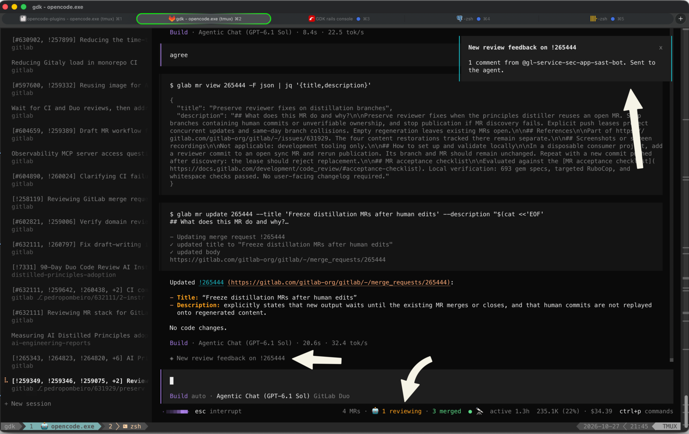
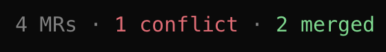
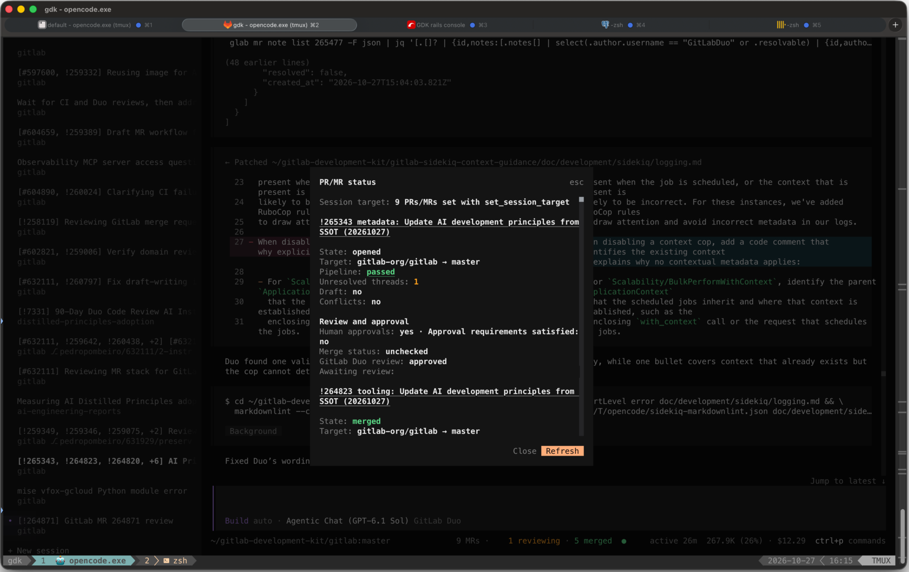

# opencode-forgekeeper

An [OpenCode](https://opencode.ai) plugin that keeps coding sessions connected to their issues,
PRs/MRs, review feedback, and CI status. It supports GitHub and GitLab.

Session titles include the references you're working on. The prompt footer shows what needs
attention, and optional summaries bring review feedback back into the relevant conversation.
A session can track several PRs/MRs across repositories.



This capture shows optional session delivery. Current releases default to the feedback inbox;
notification wording has changed since this capture.

## Installation

Requires OpenCode 2.2 or later, plus an authenticated [`gh`](https://cli.github.com/) for GitHub
or [`glab`](https://gitlab.com/gitlab-org/cli) for GitLab. The CLI must be available on the
OpenCode server's `PATH`; only the CLI for your forge is required.

```sh
opencode plugin add opencode-forgekeeper
```

OpenCode loads the server and terminal parts automatically. Forgekeeper uses your forge CLI's
credentials and has none of its own. Without a forge CLI, session naming still works, and
`/forge-status` explains what's missing.

For self-managed hosts, configure `hosts` for GitLab hosts not named `gitlab.*`, or
`githubHosts` for GitHub Enterprise.

## Session targets

Ask the agent to work on an issue or PR/MR. Forgekeeper provides `set_session_target` and
instructions for the agent to keep the session's target up to date, including after creating
a PR/MR. Targets persist across reloads and need not match the checked-out branch.

For example, a session working on issue `#12` and MR `!45` gets a title prefix such as
`[#12, !45]`. Several targets produce `[!101, !102]`, or `[!101, !102, !103, +3]` for a larger set.
Your own title text is preserved.

Without an explicit target, naming follows the checked-out branch and its open PR/MR. Ask the
agent to return to branch-based naming when you want that behavior again. Default branches
get no branch-based prefix. Child sessions aren't renamed.

See the reference for [target rules](docs/reference.md#session-targets) and
[branch-based naming](docs/reference.md#branch-based-naming).

## PR/MR status

The footer shows CI, unresolved threads, conflicts, approvals, and running automated reviews.
Several targets show aggregate counts. Click the PR/MR number or pipeline to open it in the
browser, or another indicator to open the status dialog.

For example, this footer tracks four MRs, with one conflict and two already merged:





| Command | Action |
| --- | --- |
| `/forge-status` | Show detailed status and refresh it. Aliases: `/mr-status`, `/pr-status`. |
| `/forge-open` | Open the PR/MR in your browser. Aliases: `/mr-open`, `/pr-open`. |
| `/forge-feedback` | Browse pending review feedback and PR/MR updates. |

Status normally refreshes every 2 minutes, or every 30 seconds during automated reviews.
Explicit PR/MR targets take precedence over title references and branch discovery. Issue
targets have no PR/MR status.

## Reviews and updates

Forgekeeper watches explicit PR/MR targets for human and automated review feedback, conflicts,
failed jobs, and merges. Recent top-level sessions can receive updates even if their tabs
aren't open. Branch-derived PRs/MRs get status but no review notifications.

By default, updates go to a persistent local inbox. In `/forge-feedback`, select an update to
open its links, acknowledge it, summarize it in its session, or pause monitoring.
Acknowledging an update doesn't reply to or resolve a remote discussion.

To bring summaries into conversations automatically, set both delivery options to `summary`:

```json
{
  "plugins": [
    {
      "package": "opencode-forgekeeper",
      "options": {
        "delivery": { "reviews": "summary", "lifecycle": "summary" }
      }
    }
  ]
}
```

Each delivery option accepts:

- `inbox`: retain the update without posting to the session. This is the default.
- `passive`: queue a notice without starting a turn.
- `summary`: start a restricted summary turn after active work finishes. Review updates
  without comments use a passive notice instead.

Human and GitLab Duo feedback wait for a five-minute quiet period. Monitoring records an
initial baseline rather than announcing existing feedback. Pending updates survive reloads
and clear when acknowledged or no longer relevant; merge updates remain until acknowledged.

Forgekeeper reports failed jobs but doesn't retry or fix them. For tracked stacks, it can
also propose retargeting dependents after a parent merges, but never retargets or rebases itself.

See [review detection and summaries](docs/reference.md#review-notifications),
[monitoring eligibility](docs/reference.md#which-sessions-the-server-watches), and
[stacked PRs/MRs](docs/reference.md#stacked-prsmrs) for details.

## Options

Set options in the object form of the plugin entry in `opencode.json`, as in the example above.
Only specify values you want to change. The terminal part has no separate options.

| Option | Default | Purpose |
| --- | --- | --- |
| `status` | `true` | Set to `false` to keep only session targets and titles, without polling or notifications. |
| `hosts` | `["gitlab.com"]` | Additional recognized GitLab hosts, besides hosts named `gitlab.*`. |
| `githubHosts` | `["github.com"]` | Recognized GitHub hosts, including Enterprise. |
| `pollSeconds` | `120` | Normal status polling interval. |
| `watch.humanReviews` | `true` | Monitor human review feedback. |
| `watch.automatedReviews` | `true` | Monitor GitLab Duo and GitHub Copilot review feedback. |
| `watch.reviewBots` | `true` | Monitor configured review-bot accounts. |
| `watch.lifecycle` | `true` | Monitor conflicts, failed jobs, and merges. |
| `reviewBots` | GitLab.com security reviewers | Exact bot usernames by host. Your list replaces the defaults. |
| `delivery.reviews` | `"inbox"` | Review delivery: `inbox`, `passive`, or `summary`. |
| `delivery.lifecycle` | `"inbox"` | Conflict, job-failure, and merge delivery. |
| `lifecycleExecution.parentMerged` | `{ "mode": "notify" }` | Optionally prepare retarget proposals for tracked dependents. |

See the [configuration reference](docs/reference.md#options) for validation behavior and
[review-bot configuration](docs/reference.md#review-notifications) for account matching.

## Security and privacy

Monitoring reads forge data through your authenticated CLI. It doesn't modify the forge,
edit files, commit, push, reply to comments, or resolve discussions.

Optional review summaries send review text to the session's model, isolated from conversation
history and ordinary tools. On GitLab, a restricted tool can read notes directly linked by
the announced comments, including private notes your credentials can access on the same host.
Review content is treated as untrusted data.

The inbox stores identifiers, links, and timestamps locally, not comment bodies or credentials.
Summary records temporarily retain review text in plugin storage. This is not OS-level
isolation, and the implementation has not received AppSec approval.

See the [security boundary](docs/reference.md#monitoring-security-boundary) and
[summary restrictions](docs/reference.md#summary-turns) for limits and retention details.

## Upgrading

- **From 2.x:** option names changed, and feedback now defaults to the inbox rather than
  resuming a session. Follow the [2.x upgrade guide](docs/reference.md#upgrade-from-forgekeeper-2x).
- **From `opencode-forge-session-title` or Forgekeeper 1.x:** replace the package entry.
  Stored targets don't carry over. Follow the
  [migration guide](docs/reference.md#migrating-from-opencode-forge-session-title).

## Development

From the repository root:

```sh
mise run test
mise run typecheck
mise run lint
mise run build forgekeeper
```

The reference includes the [RPC API](docs/reference.md#rpc) and
[code layout](docs/reference.md#code-layout).

## License

[MIT](../../LICENSE)
