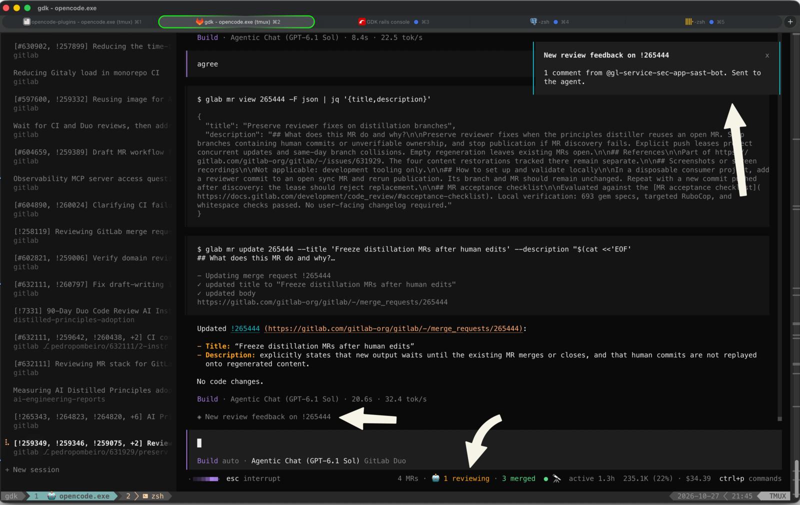
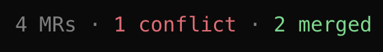
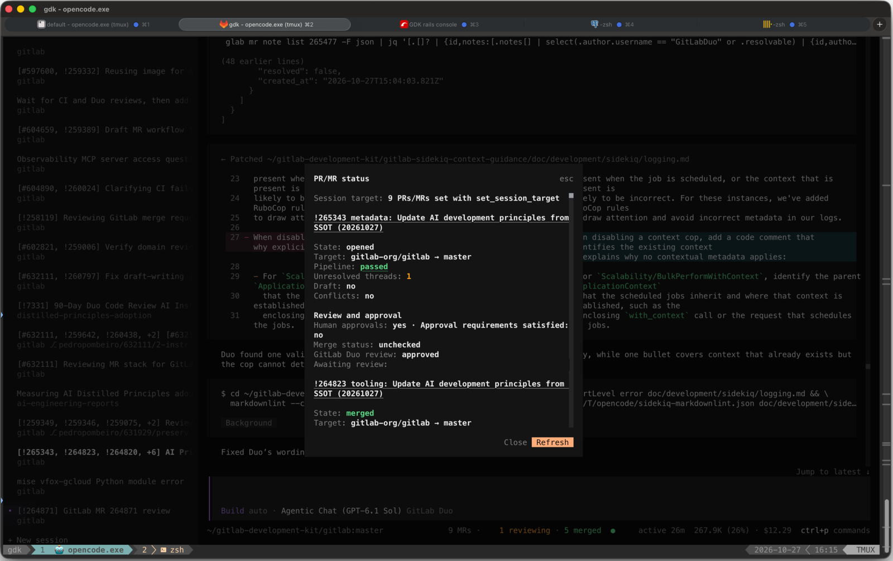
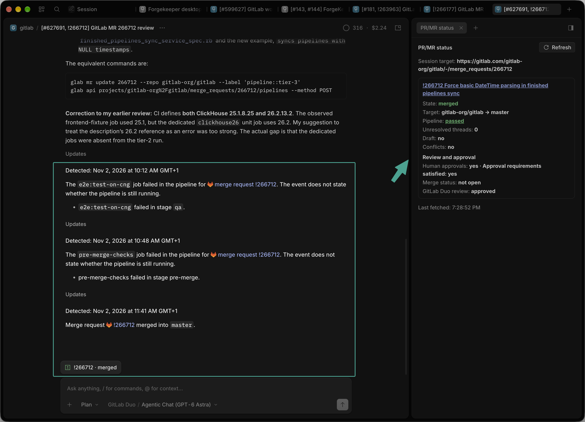
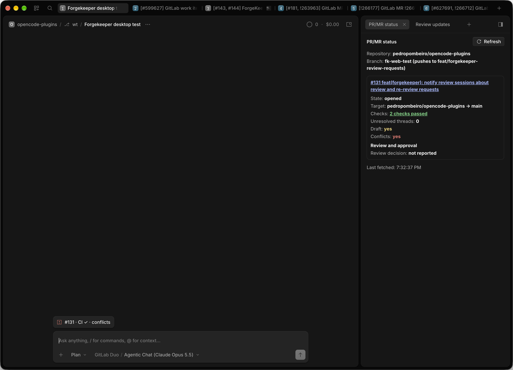

# opencode-forgekeeper

An [OpenCode](https://opencode.ai) plugin that keeps coding sessions connected to their issues,
PRs/MRs, review feedback, and CI status. It supports GitHub and GitLab.

Session titles include the references you're working on. The prompt footer shows what needs
attention, and automatic summaries bring review feedback back into the relevant conversation.
A session can track several PRs/MRs across repositories.



Notification wording has changed since this capture.

## Installation

Requires OpenCode 2.3 or later, plus an authenticated [`gh`](https://cli.github.com/) for GitHub
or [`glab`](https://gitlab.com/gitlab-org/cli) for GitLab. The CLI must be available on the
OpenCode server's `PATH`; only the CLI for your forge is required.

```sh
opencode plugin add opencode-forgekeeper
```

OpenCode loads the server, terminal, and desktop parts automatically. Forgekeeper uses your
forge CLI's credentials and has none of its own. Without a forge CLI, session naming still works, and
`/forge-status` explains what's missing.

For self-managed hosts, configure `hosts` for GitLab hosts not named `gitlab.*`, or
`githubHosts` for GitHub Enterprise.

## Session targets

Ask the agent to work on an issue or PR/MR. Forgekeeper provides `set_session_target` and
instructions for the agent to keep the session's target up to date, including after creating
a PR/MR. Targets persist across reloads and need not match the checked-out branch. A new
session for a general question has no target, title prefix, or PR/MR status.

For example, a session working on issue `#12` and MR `!45` gets a title prefix such as
`[#12, !45]`. Several targets produce `[!101, !102]`, or `[!101, !102, !103, +3]` for a larger set.
Your own title text is preserved.

Run `/forge-detach` to clear all explicit targets without a model call. To remove only specific
targets, pass their full URLs separated by spaces. Removing the last target clears the
Forgekeeper title prefix and PR/MR status. The agent can also clear all targets with
`set_session_target({ target: "none" })`. Child sessions aren't renamed.

See the reference for [target rules](https://github.com/pedropombeiro/opencode-plugins/blob/main/packages/forgekeeper/docs/reference.md#session-targets).

## PR/MR status

The footer shows CI, unresolved threads, conflicts, approvals, and running automated reviews.
Several targets show aggregate counts. Click the PR/MR number or pipeline to open it in the
browser, or another indicator to open the status dialog.

For example, this footer tracks four MRs, with one conflict and two already merged:





| Command           | Action                                                                                                    |
| ----------------- | --------------------------------------------------------------------------------------------------------- |
| `/forge-status`   | Show detailed status and refresh it. Aliases: `/mr-status`, `/pr-status`.                                 |
| `/forge-open`     | Open the PR/MR in your browser. Aliases: `/mr-open`, `/pr-open`.                                          |
| `/forge-feedback` | Browse pending review feedback and PR/MR updates.                                                         |
| `/forge-cleanup`  | Archive idle sessions whose PRs/MRs have merged or tracked issues have closed, and close their open tabs. |

When all PRs/MRs for a session merge, or all tracked issues for an issue-only session close,
Forgekeeper shows an inline reminder in the session and offers **Clean up session** in the
status dialog and panel. Issue-only sessions check their issue status when opened, after a turn
ends, when targets change, or on manual refresh.

In OpenCode Desktop, a pill above the composer shows the same status, and the commands
above open side panels for the status and the inbox. Server notices appear as toasts and
system notifications.



Conflicts appear in both the composer pill and the status panel:



The OpenCode web app loads neither the terminal nor the desktop part, but it offers three
commands that answer in the conversation:

| Command         | Action                                                                                                              |
| --------------- | ------------------------------------------------------------------------------------------------------------------- |
| `/forge-report` | Show the PR/MR status of the session.                                                                               |
| `/forge-inbox`  | List the session's pending updates. `ack <id>` or `ack all` acknowledges them, and `summarize <id>` summarizes one. |
| `/forge-prune`  | List or archive (`<id>` or `all`) idle sessions whose PRs/MRs have merged or tracked issues have closed.            |

Each answer is a short tool-free model turn that shows a report written from forge data.
Those apps don't display the text of messages that plugins add, so the model shows it.
The report stays out of the session's history.

Status normally refreshes every 2 minutes, or every 30 seconds during automated reviews and
while new review feedback settles.
Status shows only PR/MRs set as session targets. Forgekeeper does not infer targets from
the session title or the checked-out branch. Issue targets have no PR/MR status.

## Reviews and updates

Forgekeeper watches explicit PR/MR targets for human and automated review feedback, reviewer
approvals, conflicts, failed jobs, requested changes, and merges. Recent top-level sessions can
receive updates even if their tabs aren't open.

New checkouts show status without collecting inbox updates. Open `/forge-feedback` and choose
**Enable feedback inbox** (Ctrl+S in the terminal) to start monitoring this checkout. Set
`inbox: true` to enable monitoring by default. Automation rules also opt in. A saved checkout
preference takes precedence, including one from before the upgrade.

**Mark all as read** (Ctrl+U in the terminal) clears the badge for the displayed updates and
keeps them in the inbox. An update arriving afterward stays unread. **Acknowledge** dismisses
an update locally. Neither action replies to or resolves a remote discussion.

To enable monitoring and summarize lifecycle updates automatically:

```json
{
  "plugins": [
    {
      "package": "opencode-forgekeeper",
      "options": {
        "inbox": true,
        "delivery": { "lifecycle": "summary" }
      }
    }
  ]
}
```

Each delivery option accepts:

- `inbox` (default): retain the update without posting to the session.
- `passive`: queue a notice without starting a turn.
- `summary`: start a restricted summary turn after active work finishes. Review updates without
  comments use a passive notice instead.

Human and GitLab Duo feedback wait for a four-minute quiet period, with status polling every
30 seconds meanwhile, so an update arrives within about 5 minutes of the last comment. That's
before a typical 5-minute prompt cache expires. Monitoring records an initial baseline rather
than announcing existing feedback. Pending updates survive reloads and clear when acknowledged
or no longer relevant; merge updates remain until acknowledged.

On GitLab, a request for your review, including a repeated one, also becomes an update. It
links the author's replies since the previous request, including those in resolved threads. A
request is informational and never starts review automation.

Forgekeeper reports failed jobs but never retries or fixes them. For tracked stacks, it can
also propose retargeting dependents after a parent merges, but never retargets or rebases itself.

Optionally, `automation.rules` lets exact reviewers on exact projects, such as GitLab Duo, start
a coding turn that prepares fixes for their feedback, or a restricted owning-session follow-up turn
when a watched non-human reviewer explicitly approves (providing only target-bound status reads and
marking that verified draft PR/MR ready, with all general tools disabled). Human reviewer approvals
are informational only and never start a turn with tools. Review preparation runs only on PRs/MRs
you wrote, or that an account in the rule's `authors` wrote, in the one session that targets them,
with the checkout on the source branch. A rule can require models you trust with code changes. The
turn uses the session's instructions and permissions, and leaves changes uncommitted. In
`/forge-feedback`, **Act on feedback** (Ctrl+A) starts the same turn on request, and **Retry
feedback work** (Ctrl+T) retries one after you inspect it.

A `job-failed` rule investigates failed jobs on exact projects instead. Once a pipeline's
failures go quiet for four minutes, or the pipeline finishes, one turn reads the failed jobs'
logs and reports each failure's cause and a recommended fix, without changing anything. It runs
on PRs/MRs you wrote or review, or that an account in the rule's `authors` wrote, with the
checkout at the head commit the pipeline tested. See
[Investigate failed jobs](https://github.com/pedropombeiro/opencode-plugins/blob/main/packages/forgekeeper/docs/reference.md#investigate-failed-jobs).

A session that tracks several PRs/MRs is on at most one of their branches. With
`"execution": "environment"` on a rule, a batch whose checkout is elsewhere runs through the
environment provider. The current local provider runs a linked session in a worktree at the
PR/MR's head commit, and the owning session gets a notice with its path.
Forgekeeper removes the worktrees it created once their PR/MR is over and nothing in them would
be lost. See
[Run automation in an execution environment](https://github.com/pedropombeiro/opencode-plugins/blob/main/packages/forgekeeper/docs/reference.md#run-automation-in-an-execution-environment).

See [review detection and summaries](https://github.com/pedropombeiro/opencode-plugins/blob/main/packages/forgekeeper/docs/reference.md#review-notifications),
[review requests](https://github.com/pedropombeiro/opencode-plugins/blob/main/packages/forgekeeper/docs/reference.md#review-requests),
[monitoring eligibility](https://github.com/pedropombeiro/opencode-plugins/blob/main/packages/forgekeeper/docs/reference.md#which-sessions-the-server-watches),
[stacked PRs/MRs](https://github.com/pedropombeiro/opencode-plugins/blob/main/packages/forgekeeper/docs/reference.md#stacked-prsmrs), and
[preparing fixes](https://github.com/pedropombeiro/opencode-plugins/blob/main/packages/forgekeeper/docs/reference.md#prepare-fixes-from-review-feedback) for details.

## Options

Set options in the object form of the plugin entry in `opencode.json`, as in the example above.
Only specify values you want to change. The terminal part has no separate options.

| Option                            | Default                       | Purpose                                                                                                                                                                                                                                                                                                                                                                                                                                                                                                                                                                                                                                         |
| --------------------------------- | ----------------------------- | ----------------------------------------------------------------------------------------------------------------------------------------------------------------------------------------------------------------------------------------------------------------------------------------------------------------------------------------------------------------------------------------------------------------------------------------------------------------------------------------------------------------------------------------------------------------------------------------------------------------------------------------------- |
| `status`                          | `true`                        | Set to `false` to keep only session targets and titles, without polling or notifications.                                                                                                                                                                                                                                                                                                                                                                                                                                                                                                                                                       |
| `hosts`                           | `["gitlab.com"]`              | Additional recognized GitLab hosts, besides hosts named `gitlab.*`.                                                                                                                                                                                                                                                                                                                                                                                                                                                                                                                                                                             |
| `githubHosts`                     | `["github.com"]`              | Recognized GitHub hosts, including Enterprise.                                                                                                                                                                                                                                                                                                                                                                                                                                                                                                                                                                                                  |
| `pollSeconds`                     | `120`                         | Normal status polling interval.                                                                                                                                                                                                                                                                                                                                                                                                                                                                                                                                                                                                                 |
| `watch.humanReviews`              | `true`                        | Monitor human review feedback.                                                                                                                                                                                                                                                                                                                                                                                                                                                                                                                                                                                                                  |
| `watch.automatedReviews`          | `true`                        | Monitor GitLab Duo and GitHub Copilot review feedback.                                                                                                                                                                                                                                                                                                                                                                                                                                                                                                                                                                                          |
| `watch.reviewBots`                | `true`                        | Monitor configured review-bot accounts.                                                                                                                                                                                                                                                                                                                                                                                                                                                                                                                                                                                                         |
| `watch.lifecycle`                 | `true`                        | Monitor conflicts, failed jobs, requested changes, and merges.                                                                                                                                                                                                                                                                                                                                                                                                                                                                                                                                                                                  |
| `watch.issues`                    | `true`                        | Monitor related issues: outdated GitLab issue fields and open issues left behind after all tracked GitLab MRs or GitHub PRs merge. Needs `watch.lifecycle`.                                                                                                                                                                                                                                                                                                                                                                                                                                                                                     |
| `watch.reviewRequests`            | `true`                        | Monitor requests for your review on GitLab MRs, including repeated ones.                                                                                                                                                                                                                                                                                                                                                                                                                                                                                                                                                                        |
| `reviewBots`                      | GitLab.com security reviewers | Exact bot usernames by host. Your list replaces the defaults.                                                                                                                                                                                                                                                                                                                                                                                                                                                                                                                                                                                   |
| `inbox`                           | `false`                       | Enable inbox monitoring for checkouts without a saved monitoring preference. Automation rules also enable it.                                                                                                                                                                                                                                                                                                                                                                                                                                                                                                                                   |
| `delivery.reviews`                | `"inbox"`                     | Review delivery: `inbox`, `passive`, or `summary`.                                                                                                                                                                                                                                                                                                                                                                                                                                                                                                                                                                                              |
| `delivery.lifecycle`              | `"inbox"`                     | Conflict, job-failure, and merge delivery.                                                                                                                                                                                                                                                                                                                                                                                                                                                                                                                                                                                                      |
| `lifecycleExecution.parentMerged` | `{ "mode": "notify" }`        | Optionally prepare retarget proposals for tracked dependents.                                                                                                                                                                                                                                                                                                                                                                                                                                                                                                                                                                                   |
| `automation.rules`                | No rules                      | Reviewers whose feedback starts a coding turn that prepares fixes (when the checkout matches or an environment is enabled), and whose explicit non-human approvals start a restricted owning-session follow-up (even on another branch) with `forgekeeper_approval_status` and `forgekeeper_mark_ready` — for example, to honor a session instruction such as "mark this draft MR ready once Duo approves and CI is green" — or projects whose failed jobs start an investigation, optionally limited to allowed models. Set `"execution": "environment"` to permit the configured environment provider when the owning checkout doesn't match. |
| `automation.modelGroups`          | No groups                     | Named lists of `provider/model` IDs that rules reference in `allowedModelGroup`.                                                                                                                                                                                                                                                                                                                                                                                                                                                                                                                                                                |

See the [configuration reference](https://github.com/pedropombeiro/opencode-plugins/blob/main/packages/forgekeeper/docs/reference.md#options) for validation behavior and
[review-bot configuration](https://github.com/pedropombeiro/opencode-plugins/blob/main/packages/forgekeeper/docs/reference.md#review-notifications) for account matching.

## Security and privacy

Monitoring reads forge data through your authenticated CLI. It doesn't modify the forge,
edit files, commit, push, reply to comments, or resolve discussions. Only an
[automation rule](https://github.com/pedropombeiro/opencode-plugins/blob/main/packages/forgekeeper/docs/reference.md#prepare-fixes-from-review-feedback)
or **Act on feedback** starts a turn with tools, with the session's permissions: review feedback
starts a coding turn that leaves changes uncommitted, and an explicit non-human approval starts a
restricted owning-session turn exposing only `forgekeeper_approval_status` and
`forgekeeper_mark_ready` (subject to OpenCode permission rules for the bound PR/MR URL, so denying
`forgekeeper_mark_ready` keeps comment preparation while blocking draft-ready writes). Review
preparation sends reviewer text to the model as untrusted data and keeps it in the session's
history. A failed-job investigation sends job names and links the same way, and the agent reads
job logs with the session's tools.

Optional review summaries send review text to the session's model, isolated from conversation
history and ordinary tools. On GitLab, a restricted tool can read notes directly linked by
the announced comments, including private notes your credentials can access on the same host.
Review content is treated as untrusted data.

The inbox stores identifiers, links, and timestamps locally, not comment bodies or credentials.
Summary records temporarily retain review text in plugin storage. This is not OS-level
isolation, and the implementation has not received AppSec approval.

See the [security boundary](https://github.com/pedropombeiro/opencode-plugins/blob/main/packages/forgekeeper/docs/reference.md#monitoring-security-boundary) and
[summary restrictions](https://github.com/pedropombeiro/opencode-plugins/blob/main/packages/forgekeeper/docs/reference.md#summary-turns) for limits and retention details.

## Upgrading

- **From 2.x:** option names changed, and feedback now defaults to the inbox rather than
  resuming a session. Follow the [2.x upgrade guide](https://github.com/pedropombeiro/opencode-plugins/blob/main/packages/forgekeeper/docs/reference.md#upgrade-from-forgekeeper-2x).
- **From `opencode-forge-session-title` or Forgekeeper 1.x:** replace the package entry.
  Stored targets don't carry over. Follow the
  [migration guide](https://github.com/pedropombeiro/opencode-plugins/blob/main/packages/forgekeeper/docs/reference.md#migrating-from-opencode-forge-session-title).

## Development

From the repository root:

```sh
mise run test
mise run typecheck
mise run lint
mise run build forgekeeper
```

The reference includes the [RPC API](https://github.com/pedropombeiro/opencode-plugins/blob/main/packages/forgekeeper/docs/reference.md#rpc) and
[code layout](https://github.com/pedropombeiro/opencode-plugins/blob/main/packages/forgekeeper/docs/reference.md#code-layout).

## License

[MIT](https://github.com/pedropombeiro/opencode-plugins/blob/main/LICENSE)
